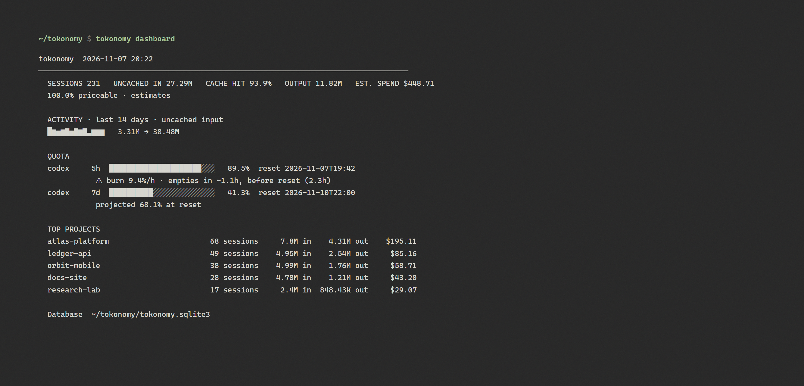
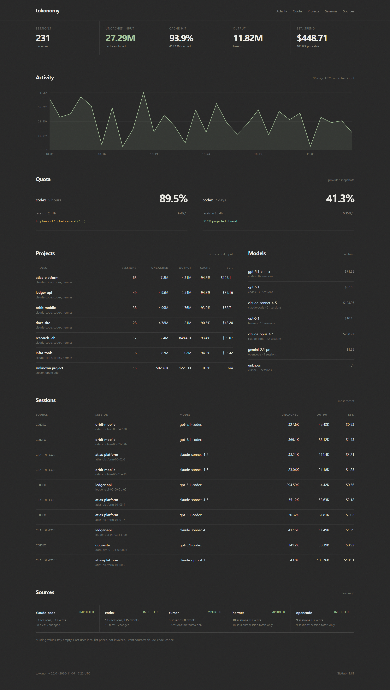

<div align="center">

</div>

tokonomy reads the session records that Codex, Claude Code, Hermes, OpenCode and Cursor already write. It keeps token counts, timestamps and quota snapshots in a local SQLite database. Prompts, responses and tool output are not stored.



## Install

Windows:

```powershell
git clone https://github.com/cenkergultekin/tokonomy.git
cd tokonomy
Set-ExecutionPolicy -Scope CurrentUser RemoteSigned
.\install.ps1
```

Open a new terminal and run `tokonomy`.

Manual install:

```bash
python -m venv .venv
. .venv/bin/activate
python -m pip install -e .
tokonomy scan --force
tokonomy web
```

The database is written to `%LOCALAPPDATA%\tokonomy\tokonomy.sqlite3` on Windows. Use `--data-dir` to select another directory. `CODEX_HOME` and `CLAUDE_CONFIG_DIR` are respected.

The background collector and login startup are Windows-only. The CLI, dashboard and MCP server are pure Python and also run on macOS and Linux.

## Use

```text
tokonomy                  terminal app
tokonomy dashboard        terminal overview
tokonomy web              localhost dashboard
tokonomy digest           7 day summary
tokonomy forecast         quota burn and reset projection
tokonomy history          observed quota periods
tokonomy export file.html static dashboard
tokonomy export file.jsonl versioned metadata
tokonomy mcp              MCP stdio server
tokonomy status --json    machine readable status
tokonomy sources          list or pause sources
tokonomy delete --source codex --yes
tokonomy doctor           data quality checks
```

## Cache accounting

Codex reports cached tokens inside `input_tokens`. Claude Code reports cached tokens in separate fields. tokonomy converts both into `uncached input` and keeps the raw values. A 1.96B input total can contain 46.6M of real context.

Missing source values stay `NULL`. Cost is calculated from a local price table and labelled as an estimate. Quota percentages only come from provider snapshots; tokonomy does not scrape the account UI.

## MCP

`tokonomy mcp` exposes `usage_summary`, `quota_status`, `project_breakdown`, `model_compare`, `recent_sessions`, `budget_check`, `coverage` and `weekly_digest` over stdio.

Claude Code:

```bash
claude mcp add tokonomy -- tokonomy mcp
```

Codex (`~/.codex/config.toml`):

```toml
[mcp_servers.tokonomy]
command = "tokonomy"
args = ["mcp"]
```

## Sources

| Source | Imported data | Token detail |
| --- | --- | --- |
| Codex CLI | rollout JSONL and JSONL.ZST | per-response usage, quota snapshots |
| Claude Code | project JSONL and subagent transcripts | per-message usage |
| Hermes | SQLite counters | session totals |
| OpenCode | SQLite counters | session totals |
| Cursor | composer headers | metadata only |

Session files are read-only. The database stores source paths, which can contain local project names.

## Development

```bash
python -m pip install -e .
python -m unittest discover -s tests -v
python scripts/make_assets.py
```

Screenshots are generated from synthetic demo data so a real project list or spend total is not published.

## License

MIT. See [LICENSE](LICENSE).
